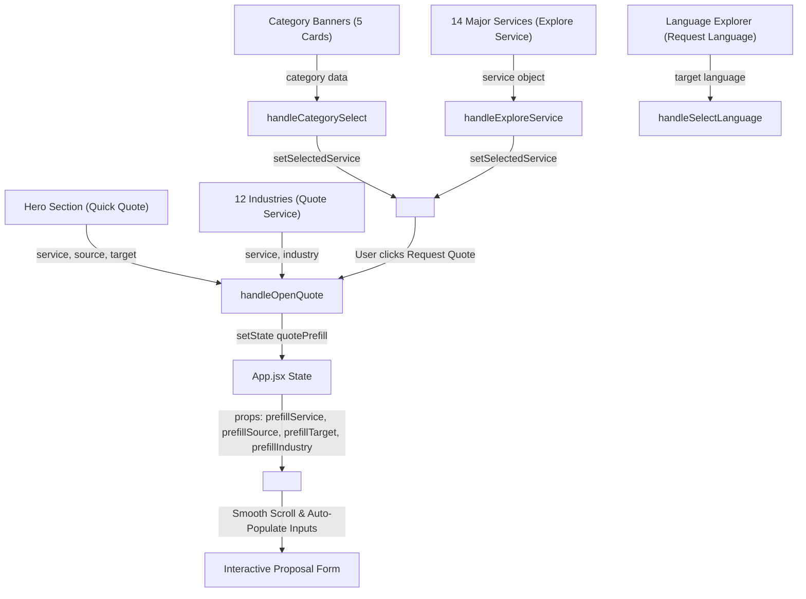

# Application Architecture — IBS (Innovative Business Solutions)

This document provides a comprehensive architectural breakdown of the **IBS – Innovative Business Solutions** single-page web application.

---

## 1. Architectural Style & Paradigms

The application is structured as a high-performance **Single-Page Application (SPA)** utilizing:

- **Component-Driven Architecture:** Isolated, modular React functional components responsible for dedicated business domains.
- **Data-Driven UI:** UI content, language catalogs, industry mappings, and service categories are decoupled from JSX templates and centralized in structured data modules (`src/data/`).
- **Unidirectional State Flow:** State management flows top-down from `App.jsx` to individual section components and interactive modal controllers.
- **Zero-Dependency Styling:** Pure vanilla CSS3 utilizing CSS Custom Properties (Design Tokens), Flexbox, CSS Grid, and GPU-accelerated CSS keyframe transitions without heavyweight runtime CSS-in-JS libraries.
- **Client-Side Progressive SEO:** Pre-rendered fallback HTML semantic markup and Schema.org JSON-LD structured data in `index.html` combined with client-side interactive React hydration.

---

## 2. Component Hierarchy & Layout Tree

The entire application runs from `src/App.jsx`, rendering sections in logical business communication sequence:

```text
<App>
  ├── <TopContactBar />          # Location (Hyderabad 500084) & 24/7 Availability
  ├── <Navbar />                 # Sticky Nav, Logo, 14-Service Dropdown, Mobile Drawer, ScrollSpy
  ├── <main id="main-content">
  │     ├── <Hero />             # Brand Tagline, Language-Pair Showcase Carousel, CTAs
  │     ├── <CategoryBanners />  # 5 Core Language Service Highlights
  │     ├── <MainServices />     # 14 Major Service Categories with Category Filter Tabs
  │     ├── <WhyChooseIBS />     # 6 Core Value Pillars (Accuracy, Confidentiality, Agility, etc.)
  │     ├── <IndustriesSection /># 12 Target Industry Verticals
  │     ├── <LanguagesSection /> # Interactive Regional Language Explorer (Search & Region Tabs)
  │     ├── <AboutUs />          # Company Milestones (Feb 2021), Hyderabad Hub Map, Founder Profile
  │     ├── <QualityPolicy />    # Linguistic QA Lifecycle & Confidentiality Protocols
  │     ├── <GetAQuote />        # Dynamic Proposal Generator with Auto-Prefill State
  │     ├── <ContactSection />   # Contact Cards, Direct Message Form, Google Maps Embed
  │     └── <BlogSection />      # Industry Insights, MTPE, Localization & Back-Translation Guides
  ├── <Footer />                 # Brand Signatures, Quick Navigation, Operating Hours, Social Links
  │
  ├── <WhatsAppButton />         # Floating Direct Support Link
  ├── <BackToTop />              # Smooth Scroll-to-Top Control
  │
  ├── <ServiceModal />           # In-depth Capabilities, Use Cases & SLAs for any of the 14 Services
  ├── <IndustryModal />          # Sector Use Cases & Tailored Language Solutions
  ├── <LanguagesModal />         # Expanded Global Language Catalog with Native Scripts
  └── <BlogModal />              # Full-Text Article Reader & Translation Case Studies
```

---

## 3. State Management & Data Flow

### 3.1 Quote Pre-Fill Pipeline
One of the core functional workflows is seamless quote initiation from anywhere on the page into the interactive `<GetAQuote />` calculator.



### 3.2 Modal Management
Modals are centralized in `src/components/Modals.jsx` and rendered at the root level of `App.jsx` to prevent z-index stacking issues, maintain clean DOM hierarchy, and ensure accessible focus traps:

- `selectedService`: Set when a user clicks "Explore Service" on any service card or highlight banner.
- `selectedIndustry`: Set when a user selects an industry card in `IndustriesSection.jsx`.
- `languagesModalOpen`: Boolean toggling the expanded language directory.
- `selectedBlogPost`: Set when a user opens an insight article in `BlogSection.jsx`.

---

## 4. Centralized Data Architecture (`src/data/`)

To ensure maintainability, content is decoupled from layout components:

| Data Module | Primary Exports | Purpose |
| :--- | :--- | :--- |
| `src/data/servicesData.js` | `CATEGORY_SERVICES`, `MAJOR_SERVICES`, `WEBSITE_MENU_SERVICES`, `ALL_SERVICES` | Master catalog of 14 major services, 5 highlight banners, included subservices, quality standards, and navbar menu mappings. |
| `src/data/industriesData.js` | `INDUSTRIES_DATA` | 12 industry sectors (Healthcare, Legal, BFSI, IT, E-commerce, etc.) with relevant language services and default quote mappings. |
| `src/data/languagesData.js` | `GLOBAL_LANGUAGE_REGIONS`, `HERO_LANGUAGE_PAIRS`, `ALL_SUPPORTED_LANGUAGES`, `ALL_LANGUAGE_NAMES` | Regional language classification (European, Asian, Middle Eastern, African), native scripts, and Hero animation language pairs. |
| `src/data/blogData.js` | `BLOG_POSTS` | Thought leadership articles, metadata, tags, reading times, and full article contents. |

---

## 5. SEO & Structured Data Architecture

The application implements a multi-layer SEO architecture designed for high organic search visibility across Hyderabad, Telangana, and international markets:

1. **Semantic HTML5 Outline:** Single `<h1>` on homepage (`Bridging Languages. Empowering Businesses.`), logical `<h2>` to `<h4>` section headers, semantic `<header>`, `<nav>`, `<main>`, `<section>`, `<article>`, and `<footer>` elements.
2. **Schema.org JSON-LD:** Structured graph containing:
   - `LocalBusiness` / `ProfessionalService`: Company address, geolocation (Kondapur, Hyderabad 500084), opening hours, and phone/email.
   - `Person` (Founder Abburi Tanuja): Founder entity linking 15+ years of industry leadership.
   - `OfferCatalog`: Full structured catalog of all 14 language and outsourcing services.
3. **Open Graph & Twitter Cards:** Complete social preview metadata with canonical image fallbacks.
4. **Dynamic Canonical Injection:** Client-side canonical URL verification script in `index.html` preventing Vite build-time `EISDIR` conflicts while guaranteeing canonical indexing.
5. **Pre-rendered Crawler Fallbacks:** Semantic fallback content in `index.html` within `<div id="root">` ensuring search crawlers parse critical business information even if client-side JavaScript is deferred.

